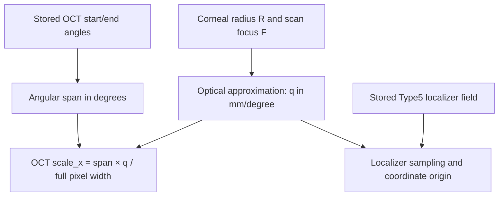

# Heidelberg Engineering E2E Format

E2E is a container for patients, studies, series and individual B-scans.
One file can contain several OCT volumes. The reader exposes both
[`EyeVolume`][eyepy.core.EyeVolume] objects and the underlying metadata.

## Read volumes

```python
import eyepy
from eyepy.io import HeE2eReader

volume = eyepy.import_heyex_e2e("filename.E2E")  # First readable OCT series.

with HeE2eReader("filename.E2E") as reader:
    print(reader)             # Overview of patients, studies and series.
    volumes = reader.volumes  # All readable OCT series.
```

!!! warning "Estimated lateral scales"
    Volumes, localizers and B-scan positions use millimeters. Lateral scales
    use an approximate optical model, and import emits a warning. Axial
    sampling is read directly from the file. This reader does not apply
    B-scan registration.

## Metric scaling

The calculation has two parts: estimate **millimeters per degree** from the
optical settings, then multiply by the scan's **degrees per pixel**. A single
conversion factor is used throughout the volume and localizer.

### Decoded optical settings

Offsets below are bytes from the start of the container payload, after its
60-byte header. Numeric fields are little-endian.

| Input | Stored location | Encoding / units |
| --- | --- | --- |
| Corneal radius `R` | Type39 @457; Type7 @17 for the scanned eye | float64, mm |
| Acquisition focus `F` | Type10004 @136 | float64; `F = focus_raw * 1.043 / 1000`, diopters |
| B-scan start/end `(x, y)` | Type10004 @12, 16, 20, 24 | float32, degrees |
| Full B-scan width `W` | Type10004 @8 | uint32, pixels |
| Axial sampling | Type10004 @36 | float32, mm/pixel |
| Localizer field `field_deg` | Type5 @24 | uint16, degrees |

Type5 also decodes laterality and localizer width/height at offsets 2, 12
and 14; its unknown bytes are preserved. Localizer pixel dimensions used
for scaling come from the image header.

No separate OCT angular-width scalar has been identified. The verified
representation is the distance between the Type10004 endpoints. The
localizer field is a different quantity: a 20° OCT scan can lie within a
30° localizer.

### Optical theory and the implemented approximation

A scan angle alone does not determine a retinal distance: the optics of
the eye determine its magnification.
[Garway-Heath et al. (1998), appendix p.649](https://doi.org/10.1136/bjo.82.6.643)
derive a conversion using corneal radius and ametropia (principal-point
refraction). In the paraxial model, external angle `theta` in radians gives
retinal distance `t ≈ theta / K'` in meters, where `K'` is the internal-axis
vergence in diopters. Thus the unmodified conversion is
`q0 ≈ 17.455 / K'` mm/degree; `17.455 ≈ 1000 * pi / 180` converts units.

The schematic eye uses corneal power `331.5 / R`, lens power `21.76 D`
and reduced separation `0.0043 m`. Substitution gives:

```text
K' ≈ 300.3 / R + 21.76 + A
q0 = 1 / (17.21 / R + 1.247 + A / 17.455)
```

Here `R` is in mm and `A` is ametropia in diopters. The coefficients are
the paper's rounded constants. This estimates ocular magnification without
measured axial length; it is not a complete individualized eye model.

Eyepy follows the
[FoveaAnalysis implementation](https://github.com/halirutan/FoveaAnalysis/blob/5b3cb4a3e5021043f20cd41a87655b1b996f082a/FoveaAnalysis/Modeling.m#L89-L125):
it substitutes acquisition focus `F` for `A` and multiplies by **1.02302**:

```python
q = 1.02302 / (17.21 / R + 1.247 + F / 17.455)  # mm per degree
```

Those two choices are adaptations, not established by the paper. A physical
derivation of the multiplier has not been identified, and this is not a
decoded HEYEX calibration equation. The implementation applies a uniform
linear factor across the field.



### Voxel scales

```python
angular_width = hypot(end_x - start_x, end_y - start_y)
scale_x = angular_width * q / W  # mm/pixel within a B-scan
scale_y = stored_axial_scale    # mm/pixel along depth
```

The volume uses the first B-scan's angular span, focus and axial sampling.
`W` is the **full image width**, not `imgSizeWidth` (which may count only
filled A-scans), and not `W - 1`. This sampling convention agrees with the
paired exports.

`scale_z` is the mean of the distances between successive start positions
and successive end positions after conversion to mm. It describes spacing
between B-scans. For one B-scan, `scale_z = 0`; no through-slice spacing
was measured.

For example, `R = 7.7 mm`, `F = 0.90 D`, a 30° OCT span and `W = 1536`
give `q ≈ 0.289510 mm/degree`, a width of `8.68530 mm`, and
`scale_x ≈ 0.00565449 mm/pixel` (5.65449 µm/pixel).

### Localizer sampling and coordinate origin

E2E endpoint coordinates are centered angles. EyeVolume uses positions in
mm relative to the localizer's upper-left corner. Adding half the localizer
field changes the origin; multiplying by `q` changes the units:

```python
start_pos_mm = ((start_x + field_deg / 2) * q,
                (start_y + field_deg / 2) * q)
end_pos_mm = ((end_x + field_deg / 2) * q,
              (end_y + field_deg / 2) * q)
localizer_scale_x = field_deg * q / localizer_width
localizer_scale_y = field_deg * q / localizer_height
```

For a 30° field, the angular center `(0°, 0°)` becomes `(15*q, 15*q)` mm,
while `(-15°, -15°)` becomes the upper-left origin. Converting positions
and localizer sampling by the same factor preserves their pixel alignment.
A single nominal field is applied to both axes; real-data validation so far
covers 30° square localizers.

`series.get_bscan_meta()` retains the original angular positions. The volume
receives copies with `pos_unit='mm'`.

### Validation, defaults and uncertainty

- All available Type39 slice radii and matching-eye Type7 radii must be
  finite, positive and **exactly equal**. A mismatch rejects conversion;
  the other eye's radius is excluded. Only an absent radius uses **7.7 mm**.
- Missing or non-finite focus uses **0 D**. Clinical Type7 refraction and
  the categorical eye-length preset are not used in the calculation.
- The first Type5 record at series level, or otherwise in sorted B-scans,
  must decode and have `0 < field_deg < 180`. Missing, truncated or invalid
  records raise a clear `ValueError`; there is **no 30° default**.
- Invalid angular span, image width or optical denominator also raises a
  `ValueError`. Scaling validation errors propagate through
  `import_heyex_e2e()`, `reader.volume` and `reader.volumes`.

Three native VOL comparisons without external reference volumes give
lateral-scale estimates **4.08–7.21 ppm below** the reported values.
Removing the 1.02302 multiplier instead lowers the estimate by about 2.25%.
XML `ScaleX` is rounded to 0.0001 mm/pixel in the inspected exports;
matching it after rounding does not establish exact agreement. Finer
coordinate comparisons, including different corneal radii, also show
small residuals that XML rounding alone does not explain.

These comparisons measure agreement with exported geometry, not anatomical
accuracy or a general error bound. The exact vendor calculation remains
unknown.

### Inspect the calculation

```python
with HeE2eReader("filename.E2E") as reader:
    series = next(s for s in reader.series if s.get_bscan_meta())
    print(series.get_x_scale_derivation())
    volume = series.get_volume()
    print(volume.meta["e2e_metadata"]["findings"]["scaling_x"])
    print(volume.localizer.meta["field_size"])
```

The scaling record includes the inputs, `mm_per_degree`, a µm/pixel display
value, and status `'approximate'`. A `None` radius or focus indicates use
of the documented default. The localizer-field finding identifies
`Type5@offset24:uint16` as its source.

## Access other metadata

The hierarchy is **file → patient → study → series → B-scan**.
`reader.patients`, `reader.studies` and `reader.series` provide flat lists;
each object's `substructure` and `folders` expose its children and records.
Use `reader.inspect(recursive=True, tables=True)` for a detailed overview,
or consult the [file structures](he_e2e_structures/he_e2e_structure_doc.md).

Type7 stores study-level Eye Data for each included eye, independently of
which eye has OCT data. Its [field reference](he_e2e_types/Type7.md) lists
IOP, clinical refraction, corneal radius, visual-field measurements,
cylinder, axis, corrective lens and pupil diameter. Access the records with:

```python
from eyepy.io.he.e2e_format import TypesEnum

with HeE2eReader("filename.E2E") as reader:
    for study in reader.studies:
        for folder in study.folders.get(TypesEnum.measurements, []):
            eye_data = folder.data
            print(eye_data.eye_side.name, eye_data.corneal_radius_mm)
```

The corrective-lens codes are 0=None, 1=Glasses, 2=Hard Contact Lenses,
3=Soft Contact Lenses. Measurements are separate from acquisition settings;
only the matching-eye corneal radius enters the scale calculation.

## HEYEX metadata provenance

The reader provides a HEYEX-style view and a corresponding source map:

```python
with HeE2eReader("filename.E2E") as reader:
    series = next(s for s in reader.series if s.get_bscan_meta())
    metadata = series.get_heyex_metadata(bscan_index=0)
    sources = series.get_heyex_metadata_sources(bscan_index=0)
```

Without `bscan_index`, slice-specific ART Mode, Quality and Acquisition Time
are `None`. Unresolved fields also remain `None`. Sources identify the
patient, study, series or B-scan record and any empirical or derived mapping;
the OCT camera firmware/FPGA slot assignment remains provisional.

The series view, source map, per-B-scan metadata and scale findings are
attached to `volume.meta["e2e_metadata"]`. For binary layouts, use the
generated references for [Type5](he_e2e_types/Type5.md),
[Type7](he_e2e_types/Type7.md), [Type39](he_e2e_types/Type39.md) and
[Type10004](he_e2e_types/Type10004.md).

## Acknowledgements

The reader builds on work from [OCT-Converter](https://github.com/marksgraham/OCT-Converter),
[LibE2E](https://github.com/neurodial/LibE2E), [uocte](https://bitbucket.org/uocte/uocte/wiki/Home)
and [RETIMAT](https://github.com/drombas/retimat).
