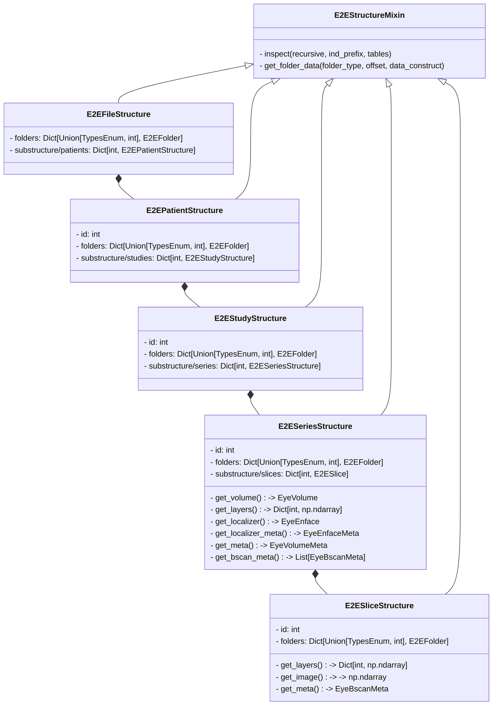

# Heidelberg Engineering E2E Format

Missing documentation of the Heidelberg E2E format has caused frustration by many working with OCT data and several projects tried to make the data accessible. Here you learn how to conveniently access data from E2E files using our [`HeE2eReader`][eyepy.io.he.e2e_reader.HeE2eReader] and what we know about the format.

## Get to know your data

One thing that makes it especially difficult to read data from E2E files is that E2E is a general container format that can contain 0 or more instances of different kinds of data. If you are interested how the data is stored you might want to continue [here](he_e2e_structures/he_e2e_structure_doc.md).

For most users it is probably enough to print the [`HeE2eReader`][eyepy.io.he.e2e_reader.HeE2eReader] object to get an overview of Patients, Studies and Series stored in the file.

```python title="Print E2E file overview"
from eyepy.io import HeE2eReader
print(HeE2eReader("filename.E2E")) # (1)
```

1.  Printing an HeE2eReader results in something similar to this:

    ```text
    E2EFile


        E2EPatient(321)


        E2EStudy(1234)
        Device: Heidelberg Retina Angiograph - Studyname: NAME

            E2ESeries(50001) - Laterality: OD - B-scans: 241
            Structure: Retina - Scanpattern: OCT ART Volume - Oct Modality: OCT - Enface Modality: IR

            E2ESeries(50002) - Laterality: OD - B-scans: 25
            Structure: Retina - Scanpattern: OCT ART Volume - Oct Modality: OCT - Enface Modality: IR
    ```

## Access data that can be parsed to [`EyeVolume`][eyepy.core.EyeVolume] objects

The [`HeE2eReader`][eyepy.io.he.e2e_reader.HeE2eReader] provides a convenient interface to access data stored in E2E files. Assuming that your E2E file contains one or more OCT volumes you can parse the volumes to [`EyeVolume`][eyepy.core.EyeVolume] objects using the following code:

```python
from eyepy.io import HeE2eReader

with HeE2eReader("filename.E2E") as e2e_reader: # (1)
    volumes = e2e_reader.volumes

with HeE2eReader("filename.E2E") as e2e_reader: # (2)
    volume = e2e_reader.volume
```

1.  `e2e_reader.volumes` returns `List[EyeVolume]`
2.  `e2e_reader.volume` returns the first Series as `EyeVolume` object

!!! Warning Limitations of EyeVolume objects created from E2E files
    + Lateral scales and positions use estimated millimeters by default. Import warns that these use an approximate optical model and may differ from HEYEX. See [Metric scaling](#metric-scaling) for the calculation and uncertainty.
    + Also we know that in the E2E file B-scans are not registered with each other. This B-scan registration information has also not been found yet. This might cause problems when downstream analysis expects B-scans to be registered.

    If you know how to read this information from the E2E file, please let us know by opening an [issue](https://github.com/MedVisBonn/eyepy/issues)

## Decoded optical settings

The following offsets are relative to the start of the container payload,
after the 60-byte container header. All three fields are little-endian float64:

| Payload | Offset | Meaning |
| --- | --- | --- |
| Type10004 | 136 | Scan focus; `focus_diopters = focus_raw * 1.043 / 1000` |
| Type10004 | 144 | Eye-length preset: -2500 Short, 0 Medium, 2500 Long, 5000 Extra Long |
| Type7 / Type39 | 17 / 457 | Corneal radius in millimeters |

The eye-length preset is a category, not a measured axial length. Unknown values
remain available as `eye_length_preset_raw` and return `None` for the category.
Both Type7 and Type39 expose the radius as `corneal_radius_mm`. Type7 holds
study-level eye records; Type39 holds slice/localizer settings. The radius
appears in all 28 Type7 eye records and all 1502 exported B-scan Type39 records
across the 14 investigated files. The two locations agree on 7.7, 9.0 or 6.2 mm.
Both eyes have identical radius settings in these examples, so conflicting
radius values between eyes or storage locations remain untested.

Type39 returns no radius when the payload is shorter than 465 bytes. This is
defensive handling: every investigated payload is 497 or 501 bytes long, and
we have no example of a missing radius or a short payload version.

Earlier versions read only the upper float32 half of the focus field at offset
140 and applied an empirical conversion. Reading the full float64 at offset 136
reproduces the investigated HEYEX focus values to their displayed precision.
The exports suggest that the vendor uses float32 precision for the factor
`1.043`. Using the ordinary decimal constant changes focus by less than
0.00000003 D across these samples and avoids unnecessary precision conversions.
Use `focus_raw` for the stored value and `focus_diopters` for the conversion.
The former `focus_candidate_raw` alias and duplicate metadata key are removed.
The series accessor is now `get_focus_raw()`; the `scan_focus` findings record
uses the keys `focus_raw` and `focus_diopters`.

### Type7 measurements

Type7 stores one 68-byte Eye Data record per eye at study level. Its fields
match the HEYEX Eye Data dialog, but their stored order differs from the UI.
Three controlled exports with distinct integer, one-decimal and two-decimal
settings verify the measurement fields and lens codes. The edited OD values
match their screenshots exactly; the OS record remains unchanged. All six
complete payloads reconstruct byte-for-byte from the reference values.

| Payload offset | Field | Encoding | Evidence |
| --- | --- | --- | --- |
| 0 | `eye_side` | uint8 | ASCII L/R eye record |
| 1 | `iop_mmHg` | float64 | IOP in mmHg |
| 9 | `refraction_dpt` | float64 | Clinical refraction in diopters |
| 17 | `corneal_radius_mm` | float64 | Controlled 9.0/6.2 mm settings validate the radius |
| 25 | `vfield_mean` | float64 | HEYEX VFieldMean; UI units unspecified |
| 33 | `vfield_var` | float64 | HEYEX VFieldVar; UI units unspecified |
| 41 | `cylinder_dpt` | float64 | Cylinder in diopters |
| 49 | `axis_deg` | float64 | Cylinder axis in degrees |
| 57 | `corrective_lens` | uint16 slot | Lens-selection code |
| 59 | `pupil_size_mm` | float64 | Pupil diameter in mm |
| 67 | `rest` | 1 byte | Meaning unknown; observed value 1 |

Lens codes match all four UI selections: **0 None**, **1 Glasses**,
**2 Hard Contact Lenses**, **3 Soft Contact Lenses**. Their high byte is zero
in these examples, so uint16 storage cannot be distinguished from uint8 plus
padding; the complete two-byte slot is retained. The pupil double begins at
unaligned byte 59, after this slot. Earlier parsers assumed eight consecutive
doubles, misplacing the pupil value and reading its final bytes as a lens code.
The final byte remains raw because its meaning is unknown.

Access both eyes through the study hierarchy:

```python
from eyepy.io import HeE2eReader
from eyepy.io.he.e2e_format import TypesEnum

with HeE2eReader("filename.E2E") as reader:
    for study in reader.studies:
        for folder in study.folders.get(TypesEnum.measurements, []):
            eye_data = folder.data
            print(eye_data.eye_side.name, eye_data.refraction_dpt,
                  eye_data.cylinder_dpt, eye_data.corneal_radius_mm)
```

Clinical `refraction_dpt` is separate from Type10004 acquisition scan focus.
The edited Eye Data records do not change the stored acquisition focus,
Type39 localizer settings or OCT image payloads in the controlled exports.
The mappings above are verified for these samples; other export versions and
negative refraction/cylinder values have not been tested.

## Metric scaling

`eyepy.import_heyex_e2e(path)` and `HeE2eReader.volume` return volumes with
`scale_unit='mm'`. The localizer and B-scan positions also use millimeters.
Each volume emits a `UserWarning` when its metric metadata is first computed.

### Optical conversion

We estimate millimeters per degree from the stored corneal radius `R` in mm
and scan focus `focus_diopters`:

```python
mm_per_degree = 1.02302 / (17.21 / R + 1.247 + focus_diopters / 17.455)
```

The denominator follows the ocular magnification model in **Garway-Heath DF
et al. (1998),** [*Measurement of optic disc size: equivalence of methods to
correct for ocular magnification*](https://doi.org/10.1136/bjo.82.6.643),
*British Journal of Ophthalmology* 82(6):643–649. The appendix on page 649
derives the expression from anterior corneal radius and ametropia (principal
point refraction in diopters). [Free full text](https://pmc.ncbi.nlm.nih.gov/articles/PMC1722616/).

The additional multiplier **1.02302** and the use of acquisition scan focus in
the refraction input follow the
[FoveaAnalysis implementation](https://github.com/halirutan/FoveaAnalysis/blob/5b3cb4a3e5021043f20cd41a87655b1b996f082a/FoveaAnalysis/Modeling.m#L89-L125).
A published derivation of that multiplier has not been identified. The paper
does not establish that E2E scan focus is equivalent to its refraction input.
The paper provides the optical model but does not independently validate this
OCT adaptation. The exact HEYEX calculation has not been established, and the
model constants have not been identified in the E2E payloads.

The [decoded optical settings](#decoded-optical-settings) describe the byte
offsets. We prefer the corneal radius in the slice's Type39 settings. If it is
unavailable, we use the Type7 measurement for the matching eye in the study.
An absent, non-finite or non-positive radius defaults to **7.7 mm**. An absent
or non-finite focus defaults to **0 D**. A non-positive optical denominator
raises `ValueError`. The eye-length preset does not enter this formula because
its relation to magnification remains unverified.

Type7 clinical refraction is not substituted for acquisition scan focus.
Cylinder, axis, pupil diameter, IOP, visual-field values and corrective-lens
selection do not enter this estimate. Editing these fields in the controlled
exports leaves the stored acquisition radius, focus and image geometry unchanged.

### Volume scales and positions

Let `q = mm_per_degree`. The Type10004 start/end coordinates are centered
angles in degrees. Let `field_deg` be the localizer field described below.
We compute:

```python
angular_width = hypot(end_x - start_x, end_y - start_y)
scale_x = angular_width * q / size_x
scale_y = stored_axial_scale
start_pos_mm = ((start_x + field_deg / 2) * q, (start_y + field_deg / 2) * q)
end_pos_mm = ((end_x + field_deg / 2) * q, (end_y + field_deg / 2) * q)
```

`size_x` is the full stored B-scan width at byte 8. `imgSizeWidth` at byte 60
can count only filled A-scans, so using it would change the physical scale
when image coverage changes. We divide by `size_x`, rather than `size_x - 1`,
following the sampling convention supported by the paired exports.
The volume's `scale_x` and `scale_y` use the first B-scan's settings.

`scale_y` is read directly from the float32 at byte 36 in mm/pixel; it does
not depend on the optical approximation. `scale_z` is the mean distance between
adjacent B-scan endpoints after conversion to mm, using `get_bscan_spacing`.
For a single B-scan there is no measured spacing: `scale_z=0`, so it does not
imply a physical volume thickness.

### Stored localizer field

The nominal IR/localizer field is **uint16 little-endian at Type5 payload
offset 24**. Neighboring uint16 values at 12 and 14 store the localizer width
and height. The reader uses the actual image header for pixel dimensions.
This field is separate from the OCT endpoint span: the investigated 20° OCT
scans have a 30° localizer.

`series.get_localizer_field_deg()` reads the first valid Type5 record from
the series, then its B-scans. A payload shorter than 26 bytes, a zero field,
or a field of 180° or greater is treated as unavailable. If no valid record
is found, the conversion uses **30°** and metadata identifies that fallback.

All 1502 Type5 records in the 14 supplied exports contain 30° and 1536×1536
pixels. Their dimensions match the image headers; their field and dimensions
also match seven E2E/XML pair comparisons covering five distinct XML exports.
The same field is decoded and used by
[OCT-Converter](https://github.com/marksgraham/OCT-Converter/blob/cb73c60aad505cc9b34d3f9ee4c44ce4888dd8f9/oct_converter/readers/binary_structs/e2e_binary.py#L88-L97).
Other localizer fields and non-square images have not been verified with real
exports. Synthetic tests cover 20° and 55° fields and missing/invalid records.

The stored field determines the localizer scales:

```python
localizer_scale_x = field_deg * q / localizer_width
localizer_scale_y = field_deg * q / localizer_height
```

Adding half the field to the centered B-scan coordinates places their origin
at the upper-left corner of this field. A single nominal field is applied to
both axes, following the inspected
[coordinate conversion](https://github.com/marksgraham/OCT-Converter/blob/cb73c60aad505cc9b34d3f9ee4c44ce4888dd8f9/oct_converter/readers/scan_geometry.py#L54-L68).
Converting both positions and localizer
scales by the same factor preserves the OCT-to-localizer pixel transform.
`series.get_bscan_meta()` retains the original angular positions; the returned
volume receives copies with `pos_unit='mm'`. Raw `start_x`, `start_y`, `end_x`
and `end_y` remain in degrees in the additional metadata.

### XML precision and observed agreement

In the investigated exports, XML `ScaleX` is rounded to **0.0001 mm/pixel**
(0.1 µm/pixel), while start/end coordinates are rounded to **0.001 mm** (1 µm).
The approximation reproduces the rounded `ScaleX` values in the three
acquisitions listed below. Removing the multiplier lowers the estimate by
**2.2502%**, a change visible even at the precision of `ScaleX`. For the
30° acquisition with a 7.7 mm radius and 0.90 D focus:

| Multiplier | Estimated mm/pixel | Rounded like XML |
| --- | --- | --- |
| 1.02302 | 0.00565449 | 0.0057 |
| 1 | 0.00552725 | 0.0055 |

The matching XML `ScaleX` is 0.0057 mm/pixel. Across the three acquisitions
below, a multiplier of 1 instead underestimates the coordinate-implied scale
by about **2.24–2.25%**.

The smaller residuals with 1.02302 are invisible in rounded `ScaleX`. We
constrain the scale using Y positions across the raster, taking the stored E2E angles as
inputs and assuming a uniform linear conversion with an unknown coordinate
origin. Allowing each XML coordinate ±0.5 µm for nearest-value rounding gives:

| OCT span / radius / focus | Scale difference versus coordinate-compatible values | Largest X/Y coordinate difference |
| --- | --- | --- |
| 30° / 7.7 mm / 0.90 D | 0.0004–0.0011% lower | 0.54 µm |
| 20° / 9.0 mm / −1.51 D | 0.0027–0.0049% higher | 0.80 µm |
| 20° / 6.2 mm / −0.49 D | 0.0069–0.0088% higher | 0.95 µm |

All three localizer fields are 30°. The last column compares both X and Y
components of the start/end positions.

Multiple rounded positions constrain the scale more precisely than a single
position. In each of these three acquisitions, the estimate falls outside the
rounding-compatible range even when the coordinate origin is free. For
example, two positions in the 30° scan have an XML separation of 3.258 mm,
permitting 3.257–3.259 mm after rounding uncertainty. The estimate is
3.256987 mm, about 0.013 µm below that range.

Under these assumptions, XML rounding alone does not explain the complete
residual. Rounding of model constants or internal numerical details could
contribute, but their contribution has not been established. These numbers
measure agreement with exported geometry; they are not independent measurements
of anatomical accuracy or a general error bound for other scans.

### Uncertainty and inspection

The calculation uses the current acquisition's optical settings and stored
angles; registration information is not interpreted. It does not reproduce
every export's HEYEX geometry. The stored localizer field has been verified
for the supplied 30° square images; other fields, devices and export versions
remain untested. Axial sampling
is read directly from the file and does not use this optical approximation.

The inputs and computed conversion are available through
`series.get_x_scale_derivation()` and
`volume.meta['e2e_metadata']['findings']['scaling_x']`, whose status is
`'approximate'`. A `None` radius or focus in that record indicates that the
documented default was used. The import warning states that lateral scales
are estimated using an approximate optical model and may differ from HEYEX.
The used field is in `volume.localizer.meta['field_size']` and
`volume.meta['e2e_metadata']['findings']['localizer_field']`. The latter gives
the source as `Type5@offset24:uint16` or `fallback:30 degrees`.

## Access other data stored in E2E files

Not everything stored in an E2E file is accessible through parsing to [`EyeVolume`][eyepy.core.EyeVolume] objects. If you are interested in accessing other data stored in the E2E file, you can use the file hierarchy created by the [`HeE2eReader`][eyepy.io.he.e2e_reader.HeE2eReader]. The structure of the build hierarchy is shown in the [diagram](#e2e-hierarchy) below. The file hierarchy can be accessed through the `file_hierarchy` attribute of the [`HeE2eReader`][eyepy.io.he.e2e_reader.HeE2eReader] object. You can either traverse the hierarchy level by level or access all elements of a specific level at once using one of the following attributes:

+ `e2e_reader.patients` returns a list of all [`E2EPatientStructure`][eyepy.io.he.e2e_reader.E2EPatientStructure] objects
+ `e2e_reader.studies` returns a list of all [`E2EStudyStructure`][eyepy.io.he.e2e_reader.E2EStudyStructure] objects
+ `e2e_reader.series` returns a list of all [`E2ESeriesStructure`][eyepy.io.he.e2e_reader.E2ESeriesStructure] objects

First you might want to get an overview about the data stored in the hierarchy. Therefore you can use the following code:

```python
from eyepy.io import HeE2eReader

with HeE2eReader("filename.E2E") as e2e_reader:
    print(e2e_reader.inspect(recursive=True)) # (1)
```

1.  This method is basically an extended version of `print(HeE2eReader("filename.E2E"))` that adds for every level of the hierarchy a table with information about the containded data.


### E2E Hierarchy



If you have any further information on the E2E format or if you find any errors in this document, please let us know by opening an [issue](https://github.com/MedVisBonn/eyepy/issues).

!!! Warning  "Open questions and differences to other Heidelberg Formats"
    + B-scan positions in the E2E format are given relative to an origin roughly in the center of the localizer image. We assume that the positions are given as angles in degree since the absolute value of minimum and maximum position is very close to half the field of view. This is different to VOL and XML formats where positions are given in mm with the origin in the top left corner of the localizer image. Since some position values indicate that they are located outside of the localizer image, we might have to apply the localizer transformation to them as well after mapping them to pixel indices.
    + VOL and XML exports store the localizer scaling, as well as the scaling of the B-scans. The VOL format even stores the distance between the B-scans which has to be calculated from the B-scans in the XML and currently also the E2E format. We did not find this scaling information in the E2E format yet and use a hardcoded value for now. The only scaling we found was the Y Scale of the B-scan.

## HEYEX Metadata Provenance

The [`E2ESeriesStructure`][eyepy.io.he.e2e_reader.E2ESeriesStructure] now exposes a HEYEX-style metadata view:

```python
from eyepy.io import HeE2eReader

with HeE2eReader("filename.E2E") as reader:
    series = reader.series[0]
    series_metadata = series.get_heyex_metadata()
    bscan_metadata = series.get_heyex_metadata(bscan_index=0)
    sources = series.get_heyex_metadata_sources(bscan_index=0)
    volume = series.get_volume()
    volume_bundle = volume.meta["e2e_metadata"]
```

The `bscan_index` argument matters because several OCT export fields are slice specific in HEYEX. If `bscan_index` is omitted, the reader leaves `OCT Image -> ART Mode`, `Quality`, and `Acquisition Time` as `None`.

When an E2E series is converted to an [`EyeVolume`][eyepy.core.EyeVolume], the same information is also attached under `volume.meta["e2e_metadata"]`. This bundle contains the series-level HEYEX metadata, provenance, per-B-scan HEYEX OCT metadata, and the current provisional findings.

### Field Scope

| Scope | Meaning |
| --- | --- |
| `patient` | Read from patient-level containers such as `Type9` |
| `study` | Read from study-level containers such as `Type13`, `Type9000`, `Type9001` |
| `series` | Read from series-level containers such as `Type10005`, `Type9005`-`Type9008` |
| `bscan` | Read from slice/B-scan containers such as `Type39` or `Type10004` |
| `derived` | Computed directly from stored values |
| `provisional` | Strong empirical mapping, but not yet proven |

### Provenance Table

| Export field | Scope | Provenance |
| --- | --- | --- |
| `General Parameters -> Examination Time` | `series` | `Type10005@series+offset16` |
| `General Parameters -> Examined Structure` | `series` | `Type9005` |
| `General Parameters -> Application` | `study/series` | `Type13`, with fallback to `Type9005` |
| `General Parameters -> Scan Focus` | `bscan/derived` | `Type10004@offset136` as `float64`, multiplied by `1.043 / 1000` |
| `IR Image -> ART Mode` | `bscan` | `Type39@offset376` |
| `IR Image -> Sensitivity (DC/DC)` | `bscan` | `Type39@offset8` |
| `IR Image -> Total Sensitivity` | `bscan` | `Type39@offset116` |
| `OCT Image -> ART Mode` | `bscan` | `Type10004@offset120` |
| `OCT Image -> Quality` | `bscan` | `Type10004@offset156` |
| `OCT Image -> Acquisition Time` | `bscan` | `Type10004.acquisitionTime` |
| `OCT Image -> Scaling Z` | `bscan` | `Type10004.scale_y` |
| `OCT Image -> Scaling X` | `derived/provisional` | Type10004 endpoint distance and full `size_x`, with the approximate optical conversion |
| `OCT Scan Pattern -> Number of B-Scans` | `bscan` | `Type10004.n_bscans` |
| `OCT Scan Pattern -> Pattern Size` | `derived/provisional` | angular span from `Type10004`, with the approximate optical conversion |
| `OCT Scan Pattern -> Distance between B-Scans` | `derived/provisional` | vertical span from `Type10004`, with the approximate optical conversion |
| `Device -> Camera Model` | `study` | `Type13` |
| `Device -> Camera Model Code` | `bscan` | ASCII model codes embedded in `Type39` |
| `Device -> Camera/Power/Touch serial numbers` | `bscan` | `Type39@offset104`, `108`, `112` |
| `Device -> HRA/Power/Touch firmware` | `bscan` | `Type39@offset128`, `132`, `136` |
| `Device -> OCT Controller FW Version` | `bscan` | `Type10004@offset124` |
| `Device -> OCT Camera FW Version` | `bscan/provisional` | `Type10004@offset128` |
| `Device -> OCT Camera FPGA Version` | `bscan/provisional` | `Type10004@offset132` |
| `Device -> Acquisition Software Version` | `bscan` | `Type39@offset140` |

### Provisional Mappings

`Scan Focus` is converted from the complete stored float64 value. Its offset,
conversion and validation are described in [Decoded optical settings](#decoded-optical-settings).

`Scaling X` in the HEYEX metadata view is reported in µm/pixel. It uses the
same radius/focus estimate as the volume's mm/pixel scale, multiplied by 1000.
See [Metric scaling](#metric-scaling) for the expression, inputs and uncertainty.

### Current Caveats

+ `Type40` currently looks related to acquisition rotation / shear geometry rather than focus. In our sample set it changes for the rotated scan but not for the other focus-varying scans.
+ `OCT Camera FW Version` and `OCT Camera FPGA Version` are assigned from `Type10004@offset128` and `Type10004@offset132` respectively, but these two slots may need to be swapped later if a dataset with distinct values proves the order is reversed.
+ `Date of Birth`, `Resolution Mode`, `Camera Objective`, `Internal Target`, `External Target`, `A-Scan Rate`, `Eye Length`, `EDI Mode`, and `EVI Mode` are still unresolved and are therefore returned as `None` by the HEYEX metadata helper.

## Acknowledgements
While building the E2E file reader, and investigating the format we took inspiration from several existing projects, which we would like to thank:

+ [OCT-Converter](https://github.com/marksgraham/OCT-Converter)
+ [LibE2E](https://github.com/neurodial/LibE2E)
+ [uocte](https://bitbucket.org/uocte/uocte/wiki/Home)
+ [RETIMAT](https://github.com/drombas/retimat)
